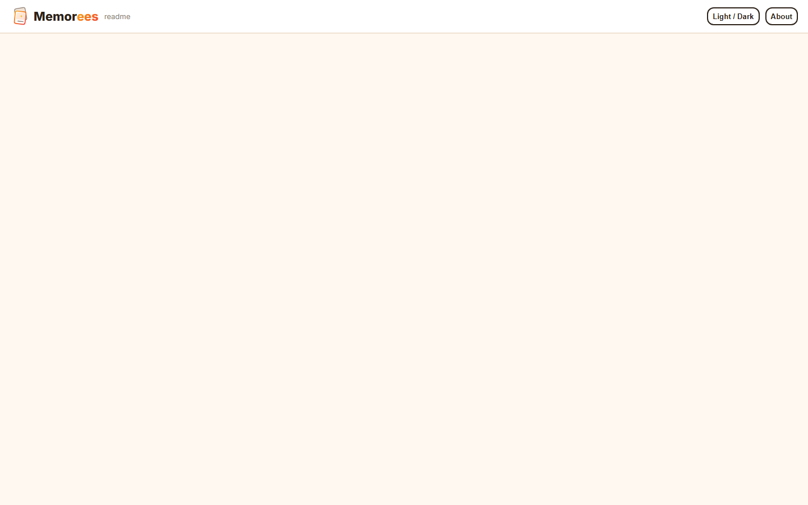
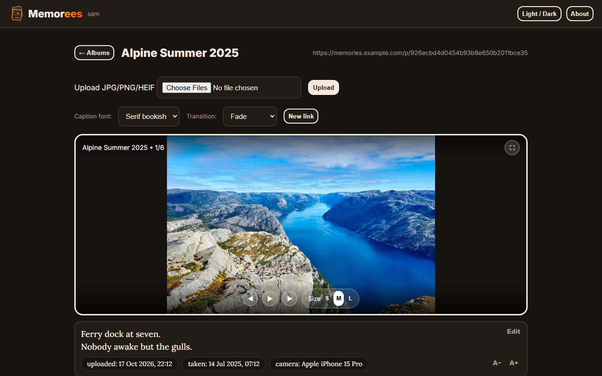
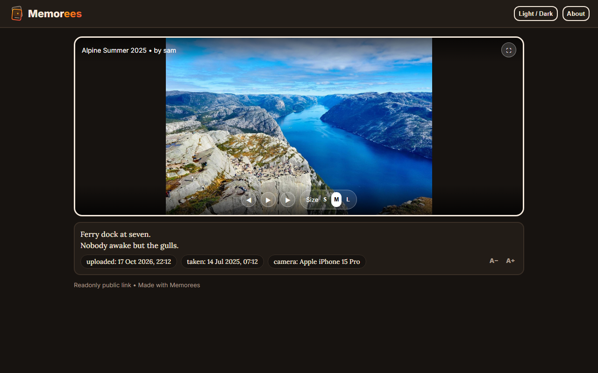
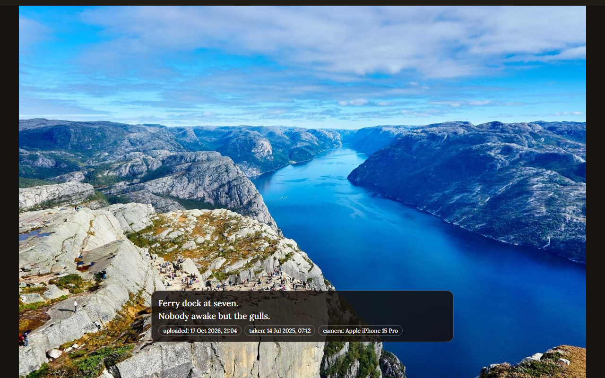
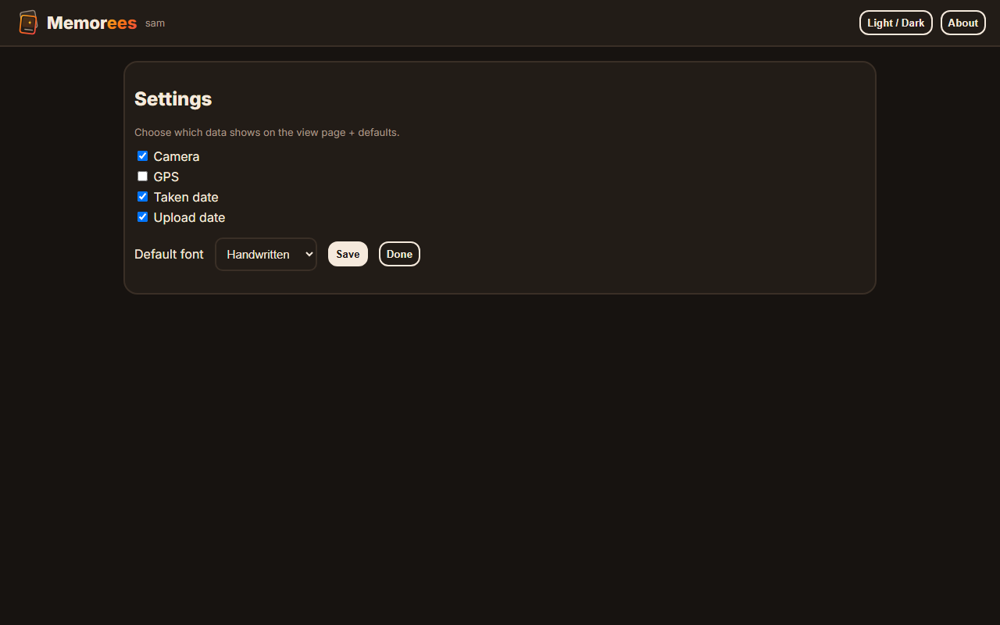
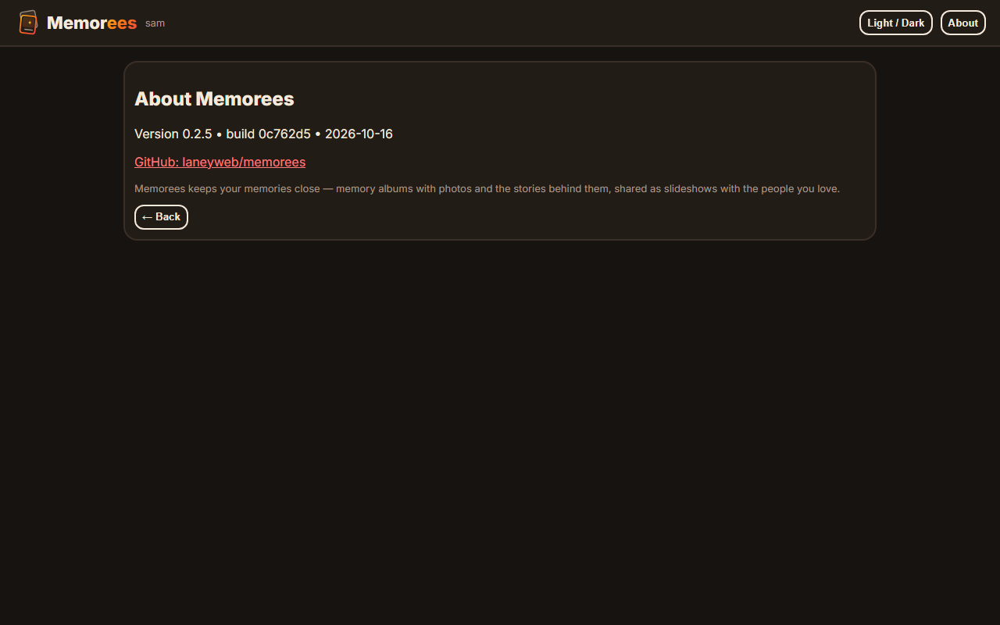
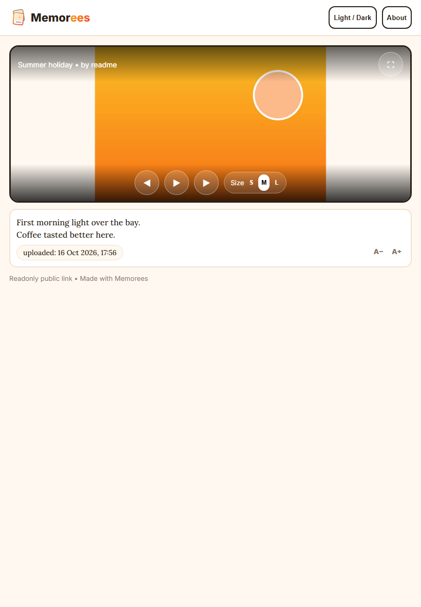

# Memorees — memory albums for your homelab

Memorees keeps your memories close — memory albums with photos and the stories behind them, shared as slideshows with the people you love. One lightweight Docker container, your photos stay on your hardware.



## What you get

- **Memory albums** — as many as you like, each with its own caption font (handwritten, modern, bookish) and slideshow transition.
- **Photos plus stories** — JPG, PNG and HEIF uploads, each photo with its own multiline comment.
- **Camera context** — camera, taken date and upload date shown beside each photo. Location stays hidden unless you opt in.
- **Public links** — every album gets a long, unguessable link. Family watch a slideshow with prev/next/pause, three sizes, fullscreen and light/dark theme. No account needed.
- **Tablet friendly** — swipe navigation and touch-sized controls.
- **Private by default** — local username/password accounts, nothing leaves your server.



## Install

You need Docker with the Compose plugin on any Linux host.

```bash
mkdir -p ~/docker && cd ~/docker
git clone https://github.com/laneyweb/memorees.git
cd memorees
cp .env.example .env
nano .env
```

Set these in `.env`:

| Setting        | What it does                                              | Example                              |
|----------------|-----------------------------------------------------------|--------------------------------------|
| `BASE_URL`     | Your public address — used to build correct share links   | `https://memories.yourdomain.com`    |
| `ALLOW_SIGNUP` | `true` for first run, then `false` to lock registration  | `true`                               |
| `HOST_PORT`    | Host port the app listens on                              | `8000`                               |
| `DATA_DIR`     | Where photos + database live (back this up)               | `./data`                             |

Then start it:

```bash
sh scripts/deploy.sh
```

Open `http://<your-host>:8000`, create your account, then set `ALLOW_SIGNUP=false` in `.env` and run `sh scripts/deploy.sh` once more to lock the door behind you.

### Expose it with Nginx Proxy Manager

Add a Proxy Host for your domain pointing at `http://<docker-host-ip>:<HOST_PORT>`. No websockets needed. Afterwards set `BASE_URL` to your public domain and redeploy so share links come out right.



## Using Memorees

**Albums** — `+ New album` to create one. Open it, upload photos (drag a whole batch), and write each photo's story with Edit on the caption. The × on a thumbnail deletes that photo (tap twice to confirm). The × on an album card deletes the album: the dialog warns that its uploaded images are erased and its public link stops working, then one click does it.

**Sharing** — the link at the top of each album page is the public slideshow. `New link` revokes the old one and mints a fresh link.

**Viewing** — slideshows start paused. Prev/next/pause, Small/Medium/Large, fullscreen (with the story overlaid), light/dark theme, and A−/A+ text size — all remembered per browser. On touch screens, swipe to move and tap the viewer to show the controls.



**Settings** — choose which details appear beside photos (camera, location, taken/upload dates), your default caption font, and theme.



**About** — shows the exact version, build and date, handy for bug reports.



## Backup and updates

- **Backup**: copy the `DATA_DIR` folder (database, originals, previews). That's everything.
- **Update**: `git pull && sh scripts/deploy.sh`. Your `.env` and data are never touched by updates.

## FAQ

**Which photo formats?** JPG, PNG, HEIF/HEIC (iPhone photos work, converted automatically for browsers).

**Where is my data?** In `DATA_DIR` on your host. Delete the container all you like — the folder is the app's memory.

**I forgot my password.** On the host: `docker compose exec memorees python3 -c "import hashlib,secrets,sqlite3; s=secrets.token_hex(16); h=hashlib.pbkdf2_hmac('sha256','NEWPASS'.encode(),bytes.fromhex(s),200000).hex(); c=sqlite3.connect('/data/memorees.db'); c.execute('update users set salt=?,hash=? where username=?',(s,h,'USERNAME')); c.commit()"`.

**Can viewers download originals?** No — public links serve display copies only.

**Does it work on tablets/phones?** Yes — responsive layout, swipe, and an iPhone-compatible fullscreen mode.



## For developers

Sample photos in the screenshots come from [Picsum](https://picsum.photos) (Unsplash License), so the repo stays free of anyone's real holiday.

See [CONTRIBUTING.md](CONTRIBUTING.md) — architecture, test suites, spec/tickets, versioning.
